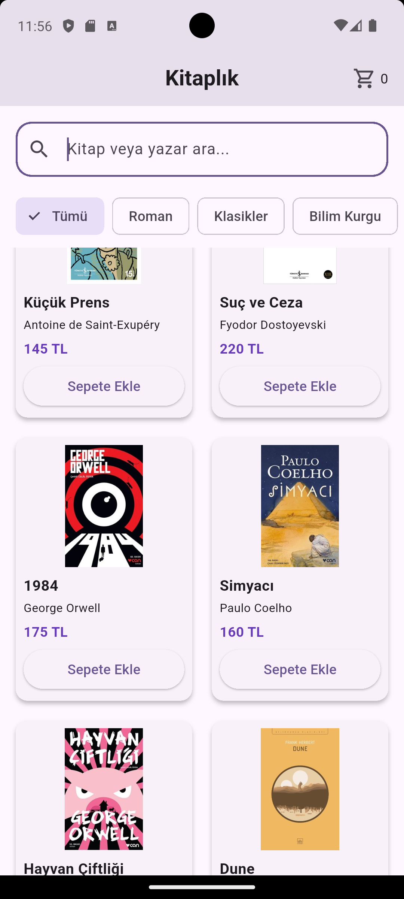
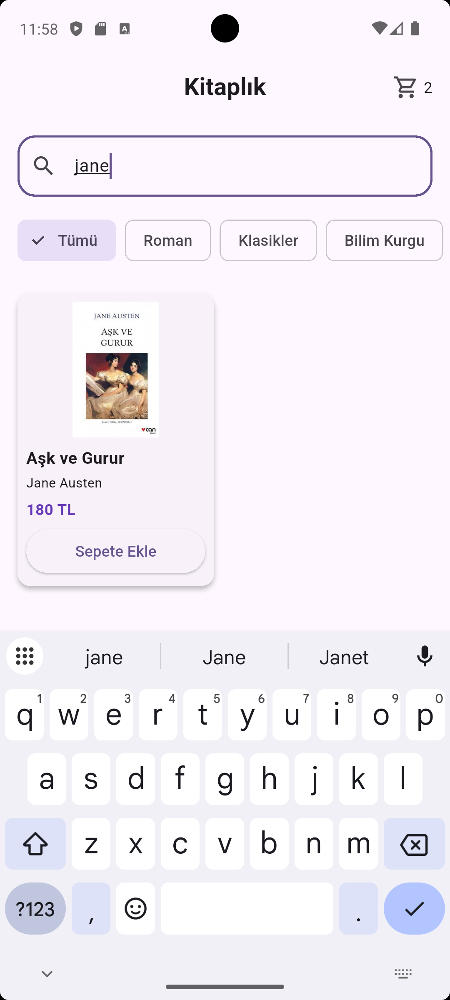
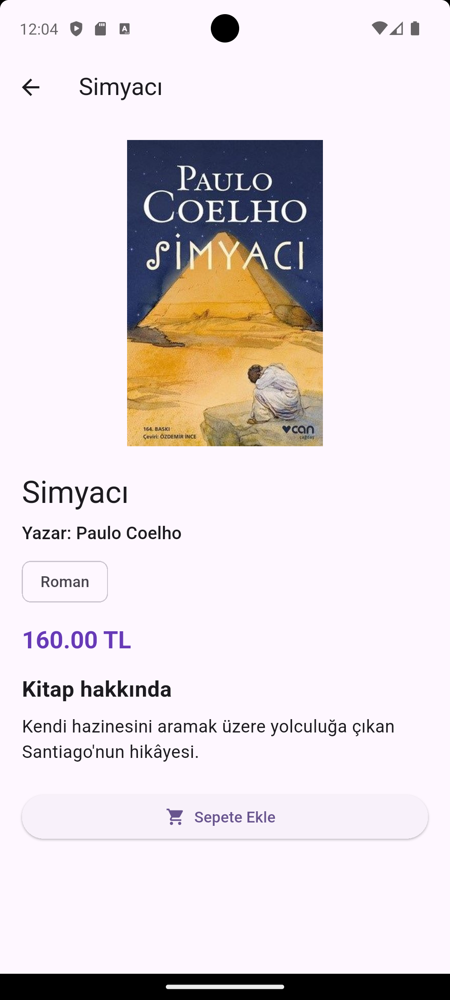
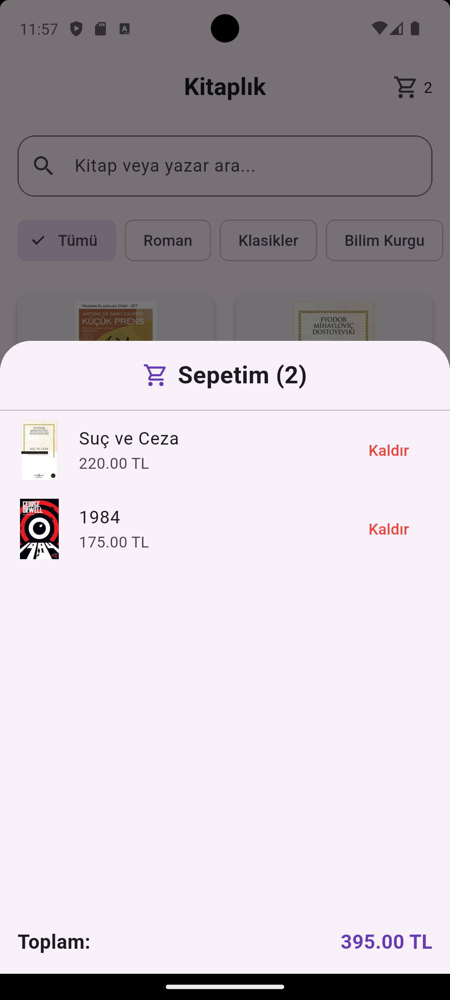

Mini Katalog — Kitap Kataloğu

Mini Katalog, Flutter ve Dart kullanılarak geliştirilmiş bir kitap katalog uygulamasıdır. Kullanıcılar kitapları inceleyebilir, arama yapabilir, kategorilere göre filtreleyebilir ve kitapları sepete ekleyebilir.

Özellikler

-Kitapları görselleriyle listeleme

-Kitap adına ve yazarına göre arama

-Kategorilere göre filtreleme

-Kitap detaylarını görüntüleme

-Sepete kitap ekleme ve çıkarma

-Sepet toplam tutarını hesaplama

-JSON dosyasından kitap verilerini okuma

-Sayfalar arasında gezinme

Kullanılan Teknolojiler ve Araçlar

-Flutter: 3.47.7

-Dart: 3.13.5

-Android Studio

-Visual Studio Code

-Material Design

-JSON

Kurulum ve Çalıştırma

Bilgisayarda Flutter SDK kurulu olmalıdır.

git clone https://github.com/cagladymn/mini_catalog.git
cd mini_catalog
flutter pub get
flutter run

Uygulama Android Studio emülatörü üzerinden de çalıştırılabilir.

Ekran Görüntüleri
### Ana Sayfa

### Kitap Arama

### Klasikler Kategorisi

### Diğer Ekran

### Sepet

Projenin Amacı

Bu proje; Flutter ve Dart ile mobil arayüz geliştirme, JSON verileri kullanma, sayfa yönlendirme ve temel durum yönetimi konularını uygulamak amacıyla hazırlanmıştır.

Geliştirici 

Çağla Adıyaman